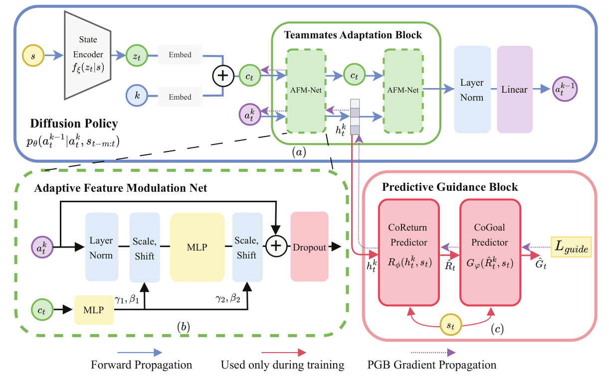

# PADiff

### Predictive and Adaptive Diffusion Policies for Ad Hoc Teamwork

<p align="center">
  <a href="https://ojs.aaai.org/index.php/AAAI/article/view/39078"></a>
  <a href="https://arxiv.org/abs/2511.07260"></a>
  <a href="https://github.com/Chancc235/PADiff"></a>
</p>

> **TL;DR.** PADiff brings diffusion policies to offline multi-agent learning for **zero-shot coordination with unseen teammates**. It learns diverse ways to cooperate from collected trajectories, combining teammate-aware prediction with adaptation as team dynamics change.
>
> **Results.** On Predator–Prey, Level-Based Foraging, and Overcooked, PADiff consistently outperforms strong baselines with held-out teammate policies. The paper reports a **35.25% average performance gain** across the tested environments.

<p align="center">
  
</p>
<p align="center"><em>Figure 3 from the paper: PADiff architecture.</em></p>

## Method

PADiff trains on trajectories collected with diverse teammate policies, then collaborates with teammates held out from training without retraining the ego policy. The diffusion model captures multiple cooperative actions. Its **Adaptive Feature Modulation Network (AFM-Net)** adjusts denoising features to the current team context; the **Predictive Guidance Block (PGB)** predicts cooperative return and goals to guide training.

## Quick Start

Run the following commands from the repository root. Experiment configurations are in [`src/config/exps/`](src/config/exps/), while PADiff training configurations are in [`PADiff/config/`](PADiff/config/).

### Step 1: Set up the environment

```bash
conda create -n padiff python=3.8 -y
conda activate padiff
bash src/install_env.sh
```

The installation script installs [`requirements.txt`](requirements.txt) and the bundled Overcooked-AI and Level-Based Foraging Python packages. You can set `PYTHON` to choose a different Python executable.

### Step 2: Train teammate policies

For Level-Based Foraging, run the first-stage teammate-policy configuration:

```bash
bash src/run_train.sh stage1_LBF
```

Use `stage1_PP` for Predator–Prey or `stage1_overcooked` for Overcooked. The corresponding configuration controls training and writes policy checkpoints under `saves/`.

### Step 3: Collect interaction trajectories

```bash
bash src/run_collect.sh collector
```

The included `collector` configuration targets Level-Based Foraging. Select the matching configuration and trained teammate policies for another environment. Collection outputs are written under `saves/`; the input directories used by each data processor are specified at the top of [`process_raw_LBF.py`](PADiff/process_data/process_raw_LBF.py), [`process_raw_PP4a.py`](PADiff/process_data/process_raw_PP4a.py), and [`process_raw_overcooked.py`](PADiff/process_data/process_raw_overcooked.py).

### Step 4: Process data and train PADiff

Point the appropriate raw-data processor to the trajectories from Step 3, then prepare reward-to-go data and train the diffusion policy:

```bash
bash PADiff/process_data/process_data.sh LBF
bash PADiff/run_train.sh --env LBF
```

The processing script accepts `PP4a`, `LBF`, or `overcooked` and writes `PADiff/data/<env>_data.pt`. PADiff training reads the corresponding configuration and writes results to `PADiff/training_output/<timestamp>/`.

## Advanced Usage

### Choose an environment

Use the environment name to select the matching PADiff configuration:

```bash
bash PADiff/run_train.sh --env PP4a       # Predator–Prey
bash PADiff/run_train.sh --env LBF        # Level-Based Foraging
bash PADiff/run_train.sh --env overcooked # Overcooked
```

To process data for a different environment, pass the same name to `process_data.sh`. The processor reads trajectory paths from its corresponding `process_raw_<env>.py` script and saves the dataset at the path used by `PADiff/config/<env>_config.yaml`.

### Training options

`PADiff/run_train.sh` forwards arguments to `PADiff/train.py`. For example:

```bash
bash PADiff/run_train.sh --env PP4a --device cuda --seed 42 --batch_size 128 --epochs 20
```

- `--device`: PyTorch device, such as `cuda`.
- `--seed`: random seed; default `42`.
- `--batch_size`: batch size; default `128`.
- `--epochs`: training epochs; default `20`.

### Training outputs

Each run creates a timestamped directory under `PADiff/training_output/` containing its configuration, training log, `loss.csv`, `test_returns.csv`, and model checkpoints in `models/`.

## Model Architecture

- **Diffusion policy:** models a multimodal distribution over cooperative actions.
- **StateEncoder:** represents recent state and teammate context.
- **AFM-Net:** adapts intermediate denoising features to the current team.
- **CoReturn and CoGoal:** form the predictive guidance used during training.

## Repository Layout

| Path | Contents |
| --- | --- |
| [`src/`](src/) | Teammate-policy training and trajectory collection |
| [`PADiff/`](PADiff/) | PADiff model, data processing, training, and evaluation |
| [`assets/`](assets/) | Architecture figure from the paper |
| [`requirements.txt`](requirements.txt) | Python dependencies |

The bundled [Overcooked-AI](src/envs/overcooked/overcooked_ai/) and [Level-Based Foraging](src/envs/lbf/lb-foraging/) environments each have one copy under `src/`; the corresponding paths under `PADiff/` link to them.

## Citation

If you use PADiff, please cite the [AAAI 2026 paper](https://ojs.aaai.org/index.php/AAAI/article/view/39078):

```bibtex
@inproceedings{chan2026padiff,
  title     = {PADiff: Predictive and Adaptive Diffusion Policies for Ad Hoc Teamwork},
  author    = {Chan, Hohei and Zhang, Xinzhi and Xiang, Antao and Zhang, Weinan and Zhao, Mengchen},
  booktitle = {Proceedings of the AAAI Conference on Artificial Intelligence},
  volume    = {40},
  number    = {24},
  pages     = {19943--19951},
  year      = {2026},
  doi       = {10.1609/aaai.v40i24.39078}
}
```

## License

PADiff is released under the [MIT license](LICENSE). Bundled third-party environments retain their own license files.
